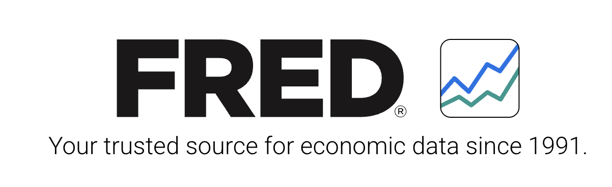

# Data Sources

::: hero-box
This page summarizes the main data sources we may use for the project **“How AI Adoption Shapes Data-Related Job Opportunities in the U.S.”** The project combines labor-market data, public interest signals, occupational information, job-posting text, news and industry reports, and economic commentary.
:::

## Planned Data Sources

::::::::: source-grid
::: source-card
{width="180px"}

### FRED Economic Data

**Description:**

FRED provides economic and labor-market time series data. We may use indicators such as unemployment, job openings, labor-force participation, employment trends, and other economic measures.

**Use in project:**

To study broad labor-market and economic conditions related to data-related job opportunities.

[Visit FRED](https://fred.stlouisfed.org/)

<small>*Logo/source image from the official FRED website.*</small>
:::

::: source-card
{width="220px"}

### BLS Occupational Outlook Handbook

**Description:**

The Occupational Outlook Handbook provides career information, including job growth, pay, education requirements, and employment outlook for different occupations.

**Use in project:**

To examine career outlooks for data science, analytics, statistics, computing, and related occupations.

[Visit BLS OOH](https://www.bls.gov/)

<small>*Logo/source image from the official U.S. Bureau of Labor Statistics website.*</small>
:::

::: source-card
{width="160px"}

### Google Trends

**Description:**

Google Trends shows search interest for selected terms over time and by location.

**Use in project:**

To track public interest and upskilling behavior for search terms such as “data science jobs,” “learn Python,” “AI careers,” and “machine learning jobs.”

[Visit Google Trends](https://trends.google.com/trends)

<small>*Logo/source image from the official Google/Google Trends website. Google and Google Trends are trademarks of Google LLC.* </small>
:::

::: source-card
{width="220px"}

### Federal Reserve Beige Book

**Description:**

The Beige Book summarizes current economic conditions across Federal Reserve districts. It includes qualitative information on hiring, labor markets, wages, business conditions, and economic expectations.

**Use in project:**

To analyze text-based economic signals related to hiring conditions, workforce trends, and AI-related labor-market changes.

[Visit Beige Book](https://www.federalreserve.gov/monetarypolicy/publications/beige-book-default.htm)

<small>*Source image from the official Board of Governors of the Federal Reserve System website.*</small>
:::

::: source-card
{width="170px"}

### Google Careers Job Postings

**Description:**\
Google Careers includes job postings for roles in software engineering, data science, machine learning, artificial intelligence, cloud computing, analytics, product, and research. These postings can provide examples of how a major technology company describes AI-related and data-related skills.

**Use in project:**\
To examine how AI-related skills, data-related responsibilities, and technical qualifications appear in real job postings from a major technology employer. These postings can be scraped and analyzed using text mining or NLP methods to identify common keywords, required skills, job titles, and changes in role descriptions.

[Visit Google Careers](https://www.google.com/about/careers/applications/jobs/results)

<small>*Logo/source image from the official Google Careers website.*</small>
:::

::: source-card
{width="150px"}

### Job Posting Data

**Description:**\
Job postings provide information about employer demand, required skills, job responsibilities, tools, and qualifications.

**Use in project:**\
To study how skill requirements are changing for data science, analytics, machine learning, AI engineering, and related roles.

**Possible sources:**\
Public job-posting datasets, curated datasets, or job descriptions collected where appropriate.

[Visit Indeed](https://www.indeed.com/)

<small>*Logo/source image from the official Indeed website. Indeed is a trademark of Indeed, Inc.*</small>
:::
:::::::::

# Common Data Sets for this project

::: contact-card
## Important Note

These data sources do not directly measure AI adoption by themselves. Instead, they provide useful indicators of the labor market and industries most closely connected to data, software, cloud computing, and information services. We will combine these sources with Google Trends and other AI-related indicators to better understand changes in demand for data-related jobs.
:::

::: contact-card
## Indeed Job Posting Indexes from FRED

The Indeed job-posting series are useful because they measure changes in online job postings over time. These series are indexed to a pre-pandemic baseline, which makes it easier to compare overall job posting activity with data-related or technology-related job categories.

### Overall Job Postings

[Job Postings on Indeed in the United States](https://fred.stlouisfed.org/series/IHLIDXUS?utm_source=chatgpt.com)

This source gives an overall measure of job posting activity in the United States. In the project, we can use this as a baseline to compare whether data-related or technology-related job postings are increasing or decreasing faster than the overall labor market.

### Software Development Job Postings

[Software Development Job Postings on Indeed in the United States](https://fred.stlouisfed.org/series/IHLIDXUSTPSOFTDEVE?utm_source=chatgpt.com)

This source is one of the most relevant for the project because software development is closely connected to AI, data science, machine learning, and automation. We can use this series to examine whether software-related job postings changed during the period of rapid AI adoption.

### IT Operations and Helpdesk Job Postings

[IT Operations and Helpdesk Job Postings on Indeed in the United States](https://fred.stlouisfed.org/series/IHLIDXUSTPITOPHE?utm_source=chatgpt.com)

This source can help us compare technical support and IT operations demand with software development demand. It may show whether AI adoption is affecting different technology-related job areas in different ways.

### Mathematics Job Postings

[Mathematics Job Postings on Indeed in the United States](https://fred.stlouisfed.org/series/IHLIDXUSTPMATH?utm_source=chatgpt.com)

This source is useful because many data-related careers depend on quantitative and analytical skills. We can use this series as a proxy for demand in math-heavy roles, including analytics, modeling, statistics, and data science.

### Scientific Research and Development Job Postings

[Scientific Research and Development Job Postings on Indeed in the United States](https://fred.stlouisfed.org/series/IHLIDXUSTPSCREDE?utm_source=chatgpt.com)

This source can help us examine demand in research-oriented jobs. Since AI is increasingly used in scientific research, this series may provide useful context for how research and technical job markets are changing.

## Data Processing, Hosting, and Related Services

These sources focus on the data-processing, hosting, cloud infrastructure, and information-services industry. This industry is highly relevant to AI adoption because AI systems depend on data storage, computing infrastructure, cloud platforms, and digital services.

### GDP: Data Processing, Hosting, and Other Information Services

[Gross Domestic Product: Data Processing, Hosting, and Other Information Services](https://fred.stlouisfed.org/series/USDATAWWWNGSP?utm_source=chatgpt.com)

This source measures the economic output of the data-processing and hosting industry. In the project, we can use it to examine whether the economic size of this industry has grown alongside the rise of AI, cloud computing, and data-driven services.

### Employment: Computing Infrastructure Providers, Data Processing, Web Hosting, and Related Services

[All Employees, Computing Infrastructure Providers, Data Processing, Web Hosting, and Related Services](https://fred.stlouisfed.org/series/CES5051800001?utm_source=chatgpt.com)

This source measures employment in the computing infrastructure and data-processing industry. It can help us study whether employment in this AI-adjacent industry has grown, declined, or changed over time.

### Employment: Data Processing, Hosting, and Related Services

[Employment for Information: Data Processing, Hosting, and Related Services](https://fred.stlouisfed.org/series/IPUJN518210W200000000?utm_source=chatgpt.com)

This source provides another employment measure for the data-processing and hosting industry. We can compare this with job-posting trends to see whether job postings and actual employment move in similar directions.

### Total Revenue: Data Processing, Hosting, and Related Services

[Total Revenue for Data Processing, Hosting, and Related Services](https://fred.stlouisfed.org/series/REVEF518ALLEST?utm_source=chatgpt.com)

This source measures revenue in the data-processing and hosting industry. It can help us examine whether the business activity of data-related services has increased during the period when AI tools and cloud-based systems became more widely used.

### Producer Price Index: Data Processing and Related Services

[Producer Price Index by Industry: Data Processing and Related Services](https://fred.stlouisfed.org/series/PCU51825182?utm_source=chatgpt.com)

This source measures price changes for data-processing and related services. It can be used to study whether the cost or pricing of data-related services has changed over time, especially as demand for cloud computing, data infrastructure, and AI-related services grows.

## Employment, Compensation, and Wages in Information and Data Processing Services

These sources provide information about workers, compensation, and wages in the information and data-processing services industry. They are useful for studying whether data-related work is growing and whether compensation is changing over time.

### Full-Time and Part-Time Employees

[Full-time and part-time employees: Information and data processing services](https://fred.stlouisfed.org/series/N4256C0A173NBEA?utm_source=chatgpt.com)

This source measures the number of employees in information and data-processing services. We can use it to examine whether employment in this industry has expanded during the period of increased AI and data-related activity.

### Compensation of Employees

[Compensation of employees: Information and data processing services](https://fred.stlouisfed.org/series/N4058C0A144NBEA?utm_source=chatgpt.com)

This source measures total employee compensation in information and data-processing services. It can help us study whether the total amount paid to workers in this industry has increased over time.

### Wage and Salary Accruals per Full-Time Equivalent Employee

[Wage and salary accruals per full-time equivalent employee: Information and data processing services](https://fred.stlouisfed.org/series/N4456C0A052NBEA?utm_source=chatgpt.com)

This source measures wages and salaries per full-time equivalent employee. It is useful for examining whether workers in the data-processing and information-services industry are receiving higher compensation over time.

## Historical Data on Purchased Computer and Data Processing Services

### Data Processing and Purchased Computer Services for Scientific R&D

[Data Processing and Other Purchased Computer Services for Scientific Research and Development Services](https://fred.stlouisfed.org/series/EXPDPSEF5417ALLEST?utm_source=chatgpt.com)

This source can be used as historical background on purchased data-processing and computer services in scientific research and development. However, this series is discontinued, so it should not be used as a main source for current trends. It is better suited for historical context.
:::

## Google Trends Data

Google Trends data will be used to measure public interest in AI-related jobs and skills in the United States. These data do not measure actual job openings, but they help us understand when people became more interested in AI careers, data science careers, and technical skills.

Possible search terms include job-related terms such as “AI jobs,” “data science jobs,” “machine learning jobs,” “AI engineer,” and “ML engineer,” as well as skill-related terms such as “Python,” “LLM,” “generative AI,” “AI agents,” “deep learning,” and “RAG system.”

In this project, we will compare Google Trends patterns with FRED and Indeed job-posting indicators. This will help us examine whether public interest in AI and data-related topics increased before, during, or after changes in software development, mathematics, scientific research, and data-processing job indicators.

::: contact-card
## How Google Trends Will Be Used in the Project

Google Trends data will be used as a measure of public interest in AI-related jobs and skills. We can compare search interest in job terms such as “AI jobs,” “data science jobs,” and “machine learning jobs” with search interest in skill terms such as “Python,” “LLM,” “generative AI,” and “deep learning.” These trends can then be compared with FRED and Indeed job-posting data to examine whether public interest and labor-market indicators appear to move together over time.

### AI and Data-Related Job Search Interest

[AI jobs](https://trends.google.com/explore?q=AI%20jobs&date=all&geo=US)

This source shows search interest in the term “AI jobs” in the United States. It can be used to examine whether public interest in AI-related employment increased during the period when AI tools became more widely used.

[Data science jobs](https://trends.google.com/explore?q=data%2520science%2520jobs&date=all&geo=US)

This source shows search interest in “data science jobs.” In the project, we can compare this trend with job-posting indicators to see whether public interest in data science careers moves together with labor-market demand.

[Machine learning jobs](https://trends.google.com/explore?q=machine%2520learning%2520jobs&date=all&geo=US)

This source shows search interest in “machine learning jobs.” It can help us understand whether interest in machine learning careers increased as AI and automation became more common in industry.

[Generative AI](https://trends.google.com/explore?q=generative%2520AI&date=all&geo=US)

This source captures search interest in “generative AI.” Since generative AI became more visible after tools such as ChatGPT became popular, this trend can help us examine whether public attention to AI increased sharply in recent years.

[AI engineer](https://trends.google.com/explore?q=AI%2520engineer&date=all&geo=US)

This source shows search interest in the term “AI engineer.” It can be useful for studying whether newer AI-specific job titles are becoming more visible to the public.

[ML engineer](https://trends.google.com/explore?q=ML%2520engineer&date=all&geo=US)

This source shows search interest in “ML engineer,” a common role connected to machine learning and applied AI. We can compare this trend with “AI engineer” and “data science jobs” to see how interest in different career paths changes over time.

### AI and Data-Related Skill Search Interest

[Python](https://trends.google.com/explore?q=python&date=all&geo=US)

This source shows search interest in Python, one of the most commonly used programming languages in data science, machine learning, and AI. In the project, Python can be used as a general indicator of public interest in data and programming skills.

[LLM](https://trends.google.com/explore?q=LLM&date=all&geo=US)

This source shows search interest in “LLM,” which stands for large language model. This term is useful for studying recent interest in generative AI systems and language-based AI tools.

[Gen AI](https://trends.google.com/explore?q=Gen%2520AI&date=all&geo=US)

This source shows search interest in the shorter term “Gen AI.” It can be compared with “generative AI” to see how different wording may capture public interest in the same broader topic.

[AI agents](https://trends.google.com/explore?q=AI%2520agents&date=all&geo=US)

This source shows search interest in “AI agents,” a newer AI-related term. It can help us examine whether interest is shifting from general AI tools toward more advanced AI systems that can perform tasks more independently.

[Open AI](https://trends.google.com/explore?q=open%2520AI&date=all&geo=US)

This source shows search interest in “Open AI.” It can be used as a public-interest indicator for one of the major organizations associated with recent AI tools. However, we should be careful because search interest in a company name may reflect news attention as well as career or skill interest.

[Deep learning](https://trends.google.com/explore?q=deep%2520learning&date=all&geo=US)

This source shows search interest in “deep learning,” an important AI method used in neural networks, computer vision, natural language processing, and generative AI. It can help us compare older AI-related terminology with newer terms such as LLM and generative AI.

[RAG system](https://trends.google.com/explore?q=rag%2520system&date=all&geo=US)

This source shows search interest in “RAG system,” which refers to retrieval-augmented generation. This is a more specialized AI term and may be useful for examining whether newer technical AI skills are gaining public attention.
:::

::: callout-note
Google Trends values are relative search-interest indexes, not counts of searches or job openings. A higher value means the term was searched more often relative to its own peak search interest during the selected time period and region.
:::

## How These Sources Work Together

The FRED and Indeed data help us understand broad labor-market and industry-level patterns. The Indeed series show changes in job postings, while the FRED industry data show trends in employment, GDP, revenue, prices, compensation, and wages. Google Trends will add another perspective by showing public interest in AI and data-related topics.

Together, these sources allow us to examine whether AI-related interest and data-adjacent labor-market activity appear to move together over time.

# Google Job Description Data

The code for collecting and analyzing Google Careers job description data is provided here: [Google Careers Description Data Scraping](google_jobs.html).

::: hero-box
# Selecting the Most Useful Data for the Dashboard

Although several datasets were downloaded for this project, the final dashboard should focus only on the data that directly supports the story about **AI adoption and data-related jobs in the United States**. Some datasets will be used as main indicators, while others will be treated as optional or supporting variables. This helps keep the dashboard clear, focused, and easier to interpret.

------------------------------------------------------------------------

## Angle 1: Job Postings and Availability of Data-Related Jobs

### Keep:

| Dataset | Use it for |
|-----------------------------|-------------------------------------------|
| Overall Job Postings | Baseline for the whole labor market |
| Software Development Job Postings | AI/data-adjacent technical demand |
| Mathematics Job Postings | Quantitative, data, and statistics-related demand |
| Scientific R&D Job Postings | Research and innovation-related demand |

### Optional:

| Dataset | Reason |
|---------------|---------------------------------------------------------|
| IT Operations and Helpdesk Job Postings | This category is technical, but it is less directly connected to AI adoption than software development, mathematics, and scientific R&D. It can be included only if the dashboard wants to compare traditional IT demand with more AI/data-related roles. |

We will start by looking at job-posting data from Indeed/FRED. To keep the dashboard focused, we will compare overall U.S. job postings with selected AI-adjacent categories: software development, mathematics, and scientific R&D. These categories are useful because they represent technical, quantitative, and research-oriented work connected to AI and data-related careers.

### Main question:

Are AI-adjacent job postings moving differently from the overall job market?

------------------------------------------------------------------------

## Angle 2: Economic Indicators Related to Data and AI Infrastructure

### Keep:

| Dataset | Use it for |
|----------------------------------------|--------------------------------|
| GDP: Data Processing, Hosting, and Other Information Services | Economic growth of the data/cloud industry |
| Employment: Computing Infrastructure Providers, Data Processing, Web Hosting, and Related Services | Actual employment in AI-supporting infrastructure |
| Wage and Salary Accruals per Full-Time Equivalent Employee | Worker compensation in the information and data-processing services industry |
| Producer Price Index: Data Processing and Related Services | Supporting indicator for price changes in data-processing services |

### Optional:

| Dataset | Reason |
|---------------------|---------------------------------------------------|
| Total Revenue: Data Processing, Hosting, and Related Services | Useful, but GDP already gives a clear measure of economic output. Revenue can be included only if you want a stronger business-growth angle. |
| Compensation of Employees | This measures total compensation, but it can increase because of more workers, higher wages, or both. Wage per full-time equivalent employee is easier to interpret. |
| Full-Time and Part-Time Employees | This may duplicate the employment series. Use only one employment measure to keep the dashboard simple. |
| Historical Data on Purchased Computer and Data Processing Services | This series is discontinued, so it should not be used as a main indicator for current trends. It is better suited for historical background only. |

Next, we will examine selected economic indicators related to data processing, hosting, cloud infrastructure, and information services. These industries are important because AI systems depend on computing infrastructure, data storage, cloud platforms, and digital services. To keep the dashboard focused, we will use GDP, employment, wages, and the Producer Price Index for data-processing services. GDP shows the economic size of the industry, employment shows workforce trends, wages show worker compensation, and PPI provides supporting context about price changes in data-processing services.

### Main question:

Is the data-processing and AI-supporting infrastructure economy growing alongside AI adoption?

------------------------------------------------------------------------

## Angle 3: Google Trends for AI Jobs and AI Skills

### Keep:

| Dataset | Use it for |
|---------------------|---------------------------------------------------|
| AI jobs | Public interest in AI-related employment |
| Data science jobs | Public interest in data science careers |
| Machine learning jobs | Public interest in machine learning careers |
| AI engineer | Interest in newer AI-specific job titles |
| Generative AI | Public attention to recent AI technologies |
| LLM | Interest in large language models and newer AI tools |
| Python | Useful as a general programming-skill indicator, but it is not only related to AI. |
| Deep learning | Relevant to AI, but it may represent an older AI term compared with generative AI and LLM. |

### Optional:

| Dataset | Reason |
|-------------|-----------------------------------------------------------|
| AI agents | Interesting and current, but it may be too new or too narrow for the main dashboard. |
| RAG system | Very specialized technical term. Better for a detailed AI-skills analysis, not the main dashboard. |
| OpenAI | Search interest may reflect company news and media attention, not only jobs or skills. |

We will use Google Trends data to measure public interest in AI-related jobs and skills. These data do not measure actual job openings, but they help show when people became more interested in AI careers and AI technologies. To keep this part focused, we will use job-related search terms such as AI jobs, data science jobs, machine learning jobs, and AI engineer, along with technology-related terms such as generative AI and LLM. These trends can then be compared with job-posting and economic indicators to see whether public interest increased during the same period as changes in the labor market and data infrastructure industry.

### Main question:

Did public interest in AI-related jobs and skills increase during the same period as changes in job postings and data-related industries?

------------------------------------------------------------------------

## Angle 4: Scraped Job Description Text

Finally, we will use scraped Google Careers job descriptions to examine the skills, tools, responsibilities, and qualifications that appear in current data-related job postings. Since these scraped descriptions may not include reliable historical dates, this part of the dashboard will be treated as a current snapshot rather than a time-series analysis. The main focus will be on identifying commonly mentioned AI-related and data-related skills, such as programming, machine learning, statistics, cloud tools, and data analysis.

### Main question:

What AI-related and data-related skills are currently appearing in job descriptions?

------------------------------------------------------------------------

## Overall Dashboard Story

Together, these four angles allow the dashboard to tell a clear story. Google Trends data shows public interest in AI jobs and skills. Job-posting data shows whether AI-adjacent job categories are moving differently from the overall labor market. Economic indicators show whether the data-processing and cloud infrastructure industry is growing. Finally, scraped job descriptions show what skills employers are currently asking for in real data-related roles.

The final dashboard will therefore focus on a smaller set of useful indicators instead of including every downloaded dataset. This will make the dashboard more professional and easier to interpret.
:::
